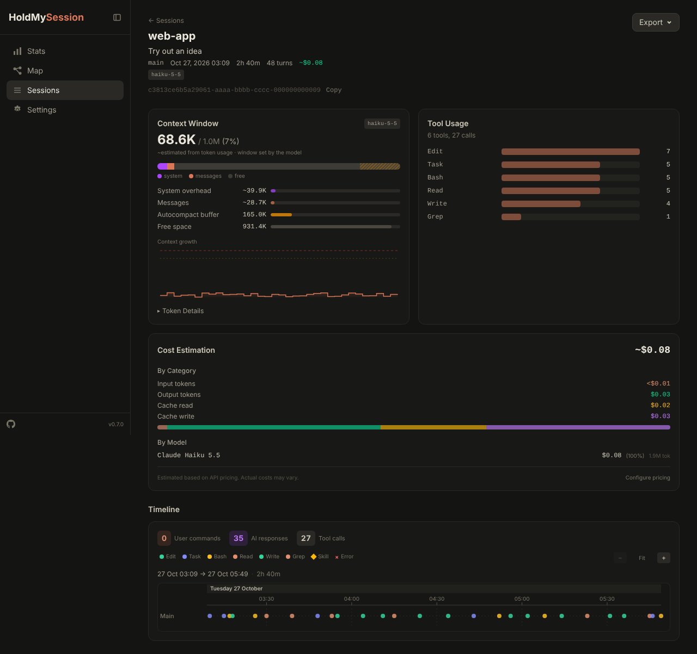
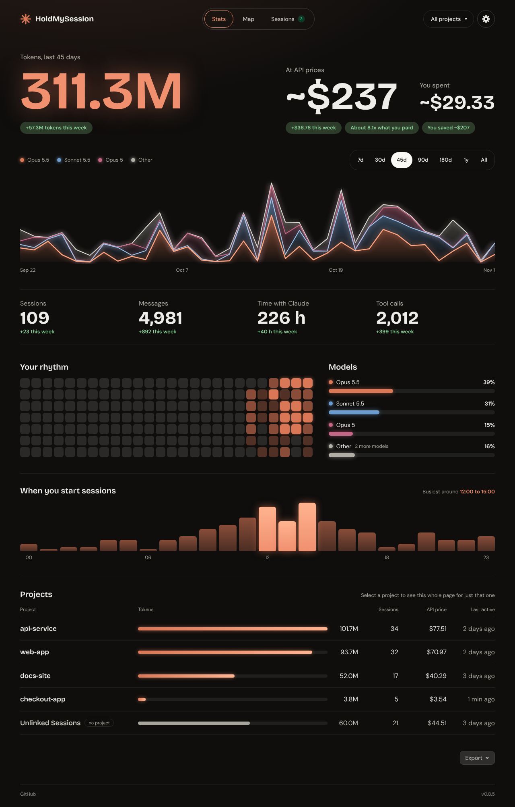
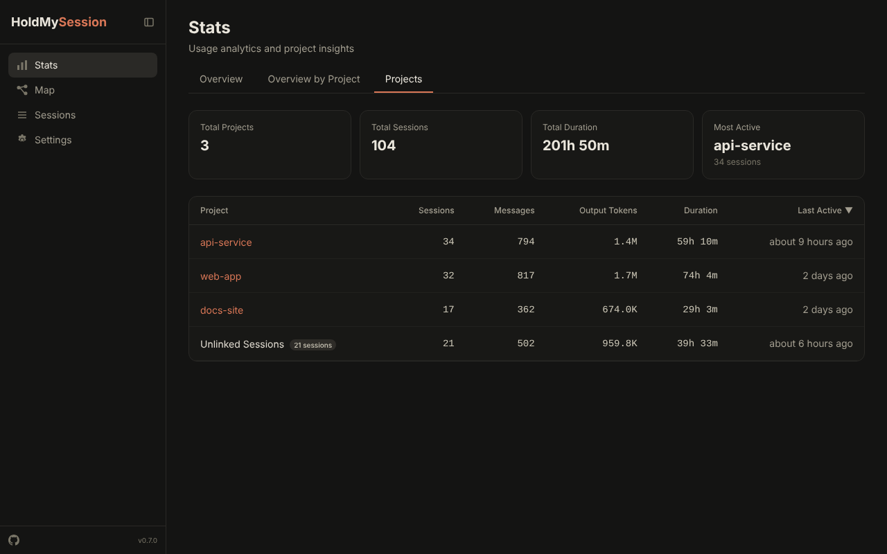
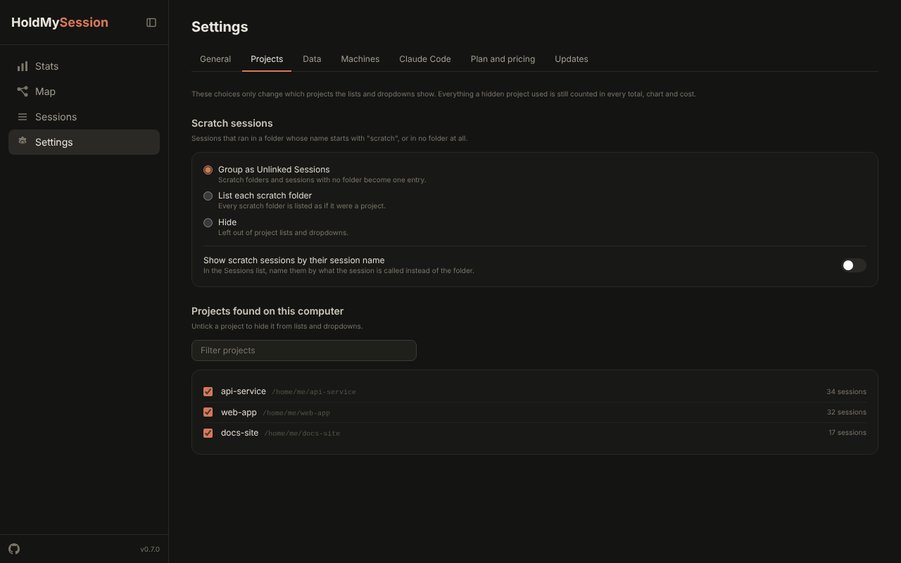

# HoldMySession

[](https://github.com/holdmysocks/HoldMySession/actions/workflows/ci.yml)
[](https://github.com/holdmysocks/HoldMySession/actions/workflows/codeql.yml)
[](https://opensource.org/licenses/MIT)

See exactly where your context window goes. Trace every agent delegation. Understand how your Claude Code workflows actually execute — all from your local `~/.claude`, no data sent anywhere.

```bash
git clone https://github.com/holdmysocks/HoldMySession.git
cd HoldMySession/apps/web
npm install && npm run build && npm start
```

## Why?

If you run Claude Code with agentic workflows and custom skills, you've probably felt this: sessions that start sharp and gradually get worse. Claude repeating itself, missing earlier context, giving shallower answers. The context window is filling up silently and you have no way to see it.

The fix is agent delegation — each subagent starts with a fresh context, keeping your main session lean. But most people do this by instinct, not by design. You can't optimize what you can't see.

This dashboard makes it visible. It reads your local session files, parses the JSONL logs, and shows you what's actually happening inside your workflows — which agents were dispatched, in what order, how much context each step consumed, and where your tokens are going.

Everything runs entirely on your machine. Read-only — it never modifies any Claude Code data.

## Features

**Agent delegation timeline** ← the unique one
- Gantt-style diagram showing every subagent dispatch in a session, in sequence
- See the full delegation chain: which agents ran, in what order, how long each took
- Token usage per agent — understand exactly how each delegation affects context consumption
- Zoom controls for detailed inspection of complex multi-agent workflows

**Context window visualization**
- Live breakdown of how your context window is being used: input, output, cache reads, cache writes. The window size is found automatically: your own auto-compact setting if you set one (`/autocompact`), otherwise the model's window (1M for the current Claude families, 200K for older ones), widened to fit when a session held more than that
- See at a glance whether your main session is staying lean or accumulating context
- Per-session and per-agent cost estimates with per-model and per-category breakdowns



**Session browsing and search**
- Full-text search across session names, projects, and branches
- Filter by status (active / completed), project, model, and date range
- Sortable columns with pagination
- Active session indicator with real-time status polling

**Analytics and stats**
- GitHub-style contribution heatmap showing token usage intensity over the past year
- Token usage over time -- stacked area chart with daily/weekly toggle, top 5 models + "Other"
- Model usage distribution across all sessions
- Hourly activity distribution chart
- Aggregate metrics: total sessions, messages, tokens, estimated cost



**Per-project analytics**
- Dedicated "Projects" tab with sortable table
- Sessions, messages, tokens, and duration aggregated per project
- Drill-down links to filtered session lists
- Sessions with no project, and sessions that ran in a folder whose name starts with `scratch`, are grouped into one **Unlinked Sessions** row with a count tag. It is not counted as a project
- **Overview by Project** tab: the same overview as the Overview tab (cards, heatmap, charts, cost), filtered to one project or to the Unlinked Sessions group. Projects are listed by their display name. The Total Tokens card shows the total, and an arrow opens the input, cache, output and reasoning breakdown



**Cost estimation**
- Configurable API pricing per model. Defaults cover Claude Fable 5.1, Opus 5.5, Sonnet 5.5 and Haiku 5.5, and earlier Opus, Sonnet and Haiku models. Haiku 5.5 uses its rate for prompts up to 100K tokens; override it for longer prompts
- Subscription tier support (Free, Pro, Max, Ultra) with appropriate rate adjustments
- Settings persisted to `~/.holdmysession/settings.json`



**Data export**
- Export stats and session data in CSV or JSON format
- Four export formats: session summaries, model usage, daily activity, project analytics
- Client-side export -- no server round-trip needed

**Real-time monitoring**
- Active sessions badge in the sidebar with 3-second status polling
- Active session banner on detail pages with adaptive refresh intervals
- Automatic data refresh for in-progress sessions

**Privacy mode**
- Toggle to anonymize project names, file paths, branch names, and usernames
- Analytics data anonymized consistently across all views
- Safe for screenshot sharing and presentations

## Quick Start

Needs Node.js 22 or newer.

### Desktop app (Windows and Mac)

Download the zip for your system from the [releases page](https://github.com/holdmysocks/HoldMySession/releases), unzip it, and run HoldMySession. It opens a window, keeps running in the tray or menu bar when you close it, and is still at http://localhost:3000 in a browser. See [docs/desktop-app.md](docs/desktop-app.md).

### From source

```bash
git clone https://github.com/holdmysocks/HoldMySession.git
cd HoldMySession/apps/web
npm install
npm run build
npm start
```

On Windows, `Update-SessionMap.ps1` in the repository root pulls, rebuilds and starts it for you.

Open [http://localhost:3000](http://localhost:3000) in your browser.

### Updating

Pull the latest changes and rebuild:

```bash
cd HoldMySession
git pull
cd apps/web && npm install && npm run build
```

## CLI Options

```
  -p, --port <number>   Port to listen on (default: 3000)
  --host <hostname>     Host to bind to (default: localhost)
  -o, --open            Open browser after starting
  --print-hook-config   Print a settings.json hooks snippet for the Session Map (Notification and Stop)
  -v, --version         Show version number
  -h, --help            Show this help message
```

> **Note:** The dashboard runs entirely on localhost and only reads files from the Claude config directory (`CLAUDE_CONFIG_DIR`, default `~/.claude`). It never modifies any Claude Code data and never sends data over the network.

## Session Map

The **Map** page (`/map`) shows one project's sessions as a tree: each session, its forks as child nodes, and its running subagents as small cards. A subagent quiet for more than 5 minutes is not drawn. Its session shows a **+N** chip instead. Sessions are coloured by status: needs you (yellow, fast pulse), active (green, slow pulse), completed in the last hour (orange), idle (grey). A side panel lists what is waiting on you and recent hook events. The map fills the window: drag to pan, scroll to zoom, **Fit** to see everything. **Edit layout** lets you drag cards where you want them. Cards snap to a grid (hold Alt to place one freely), and Ctrl-click or a Ctrl-drag box selects several to move together. The layout is saved by the dashboard, so you see it from any device. Branches grow downward, and links join the closest sides of two cards. It is read-only: moving cards never changes anything in your Claude config directory.

Sessions with no working directory in their transcripts have no project, so the map and the Sessions list hide them and show a count. Sessions archived in the Claude desktop app are hidden too, and counted. Stats and project analytics still count every session. A session the desktop app split to the top level is not linked to its old parent.

Project and session names come from the transcripts: the project from the recorded working directory, the session from its `/rename` name. Notifications need an opt-in hook. Run `holdmysession --print-hook-config` and merge the output into the `hooks` section of `settings.json` in your Claude config directory. The hook records each notification's type and title. Details, data sources, status and limitations are in [docs/session-map/README.md](docs/session-map/README.md).

## Tech Stack

- [TanStack Start](https://tanstack.com/start) -- SSR framework on Vite
- [TanStack Router](https://tanstack.com/router) -- file-based routing with type-safe search params
- [TanStack Query](https://tanstack.com/query) -- data fetching with caching and automatic background refetch
- [Tailwind CSS v4](https://tailwindcss.com/) -- utility-first styling with CSS-first configuration
- [Recharts](https://recharts.org/) -- composable charting library for timeline, heatmap, and stats visualizations
- [Zod](https://zod.dev/) -- runtime validation for server functions and URL params
- Node.js >= 18

## Project Structure

```
apps/web/src/
  routes/                        # File-based routes (TanStack Router)
    _dashboard/
      sessions/
        index.tsx                # Sessions list page
        $sessionId.tsx           # Session detail page
      stats.tsx                  # Stats + per-project analytics page
      settings.tsx               # Settings page
  features/                      # Vertical Slice Architecture
    sessions/                    # Session list, filters, active badge
    session-detail/              # Session detail, timeline, context window
    stats/                       # Activity chart, heatmap, token trends, model usage
    project-analytics/           # Per-project aggregated metrics
    cost-estimation/             # Cost calculation and display
    settings/                    # Subscription tier, pricing editor
    privacy/                     # Privacy mode toggle and anonymization
  lib/
    scanner/                     # Filesystem scanner for ~/.claude
    parsers/                     # JSONL session file parsers
    cache/                       # Persistent disk cache (heatmap data)
    utils/                       # Formatting, export utilities
  components/                    # Shared UI components (ExportDropdown, etc.)
```

## How It Works

1. **Scanning** -- The server reads `projects/` in the Claude config directory (`CLAUDE_CONFIG_DIR`, default `~/.claude`) to discover all session `.jsonl` files. Project paths come from each transcript's `cwd`, not from the directory name. An mtime-based cache avoids re-parsing unchanged files.
2. **Parsing** -- Session files are parsed to extract metadata (project, branch, duration, model), tool calls, agent dispatches, token usage, and errors.
3. **Server Functions** -- TanStack Start server functions (`createServerFn`) expose parsed data to the client via type-safe RPC. All file I/O stays on the server.
4. **React Query** -- The UI fetches data through React Query with automatic background refetch for live updates. Active sessions use adaptive polling intervals.
5. **Caching** -- Parsed session summaries and heatmap data are cached in memory (mtime-based invalidation) and on disk (`~/.holdmysession/cache/`) for fast startup.

## Development

```bash
cd apps/web

npm run dev          # Dev server on localhost:3000
npm run build        # Production build
npm run typecheck    # TypeScript type checking
npm run lint         # ESLint
npm run test         # Unit tests (Vitest)
npm run e2e          # End-to-end tests (Playwright)
```

## Contributing

Contributions are welcome! See [CONTRIBUTING.md](CONTRIBUTING.md) for setup instructions and conventions. Check [good first issues](https://github.com/holdmysocks/HoldMySession/labels/good%20first%20issue) for beginner-friendly tasks.

If you find this project useful, consider giving it a star -- it helps others discover it.

## Links

- [GitHub](https://github.com/holdmysocks/HoldMySession)
- [Issues](https://github.com/holdmysocks/HoldMySession/issues)
- [Discussions](https://github.com/holdmysocks/HoldMySession/discussions)

## License

MIT
