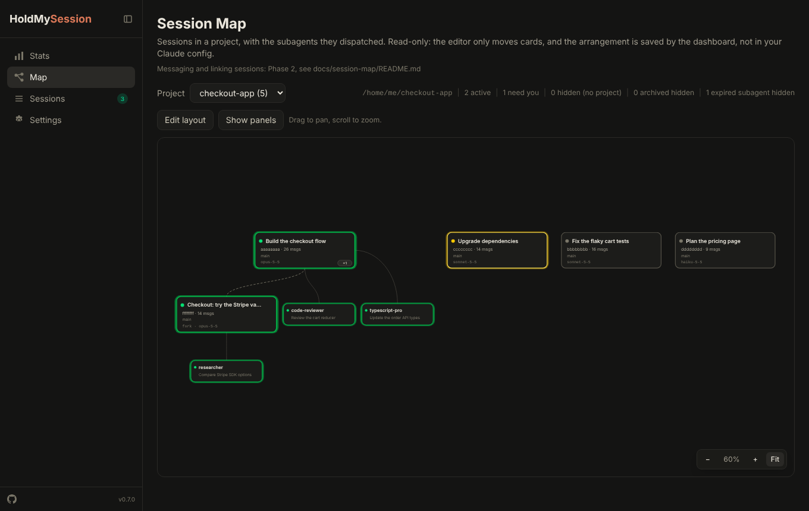

# HoldMySession

See where your Claude Code usage goes: every session, every agent, every token, and what it all costs. HoldMySession reads the session files Claude Code already keeps on your computer, keeps its own long-term history of them, and shows it in a desktop app or a browser. Nothing is sent anywhere unless you link your own machines together.


## Get it

**Desktop app (Windows and Mac).** Download the zip for your system from the [releases page](https://github.com/holdmysocks/HoldMySession/releases), unzip it anywhere you can write to, and run HoldMySession. It opens a window, stays in the tray (menu bar on a Mac) when you close it, and is also at http://localhost:3000 in any browser on that machine. It can update itself from Settings. More in [docs/desktop-app.md](docs/desktop-app.md).

The programs are not code-signed, so Windows SmartScreen or macOS Gatekeeper warns the first time. On Windows choose **More info**, then **Run anyway**. On a Mac, Control-click the app, choose **Open**, then **Open** again.

**From source.** Needs Node.js 22.13 or newer.

```bash
git clone https://github.com/holdmysocks/HoldMySession.git
cd HoldMySession/apps/web
npm install
npm run build
npm start
```

Then open http://localhost:3000.

```
  -p, --port <number>   Port to listen on (default: 3000)
  --host <hostname>     Host to bind to (default: localhost)
  -o, --open            Open browser after starting
  --print-hook-config   Print a Claude Code hooks snippet (Notification and Stop), without writing anything
  -v, --version         Show version number
  -h, --help            Show this help message
```

## What it shows

### Sessions

- A searchable, sortable list of every session, filtered by status, project, model and date. Active sessions are marked live.
- **Agent delegation timeline:** a Gantt-style view of every subagent a session dispatched, in order, with how long each ran and the tokens it used. Zoom in on busy workflows.
- **Context window:** a live breakdown of input, output and cache tokens against the window size, which is found for you: your `/autocompact` setting if you set one, otherwise the model's window.
- **Cost:** per-session and per-agent estimates, broken down by model and token kind.

### Stats

- Totals for sessions, messages, tokens and estimated cost.
- A year-long activity heatmap, daily activity, tokens over time (daily or weekly) by model, model share, and an hourly distribution.
- **Projects** tab: sessions, messages, tokens and time per project, with drill-down to a full overview filtered to one project.
- **Unlinked Sessions:** sessions with no working folder, or in a folder whose name starts with `scratch`, are grouped as one entry instead of one row each.
- Export any of it as CSV or JSON.

### History database

Stats come from HoldMySession's own SQLite file, `~/.holdmysession/history.db`, not straight from Claude's files, so your history survives Claude clearing its folder.

- A scan fills it automatically (every 15 minutes by default, adjustable) and on demand. Scanning twice never double-counts.
- Prices and your plan are kept as dated history, so an old month is costed at the prices and plan of that month.
- Back up, download, restore and delete backups from Settings. **Check against session files** compares the database with the files to prove the totals match.
- Details in [docs/history-database.md](docs/history-database.md).

### Session Map



The **Map** shows one project's sessions as a tree: each session, its forks as children, and its running subagents as small cards, coloured by status (needs you, active, recent, idle). A side panel lists what is waiting on you and recent hook events. Drag to pan, scroll to zoom, and use **Edit layout** to arrange cards; the arrangement is saved and follows you to other devices. Details in [docs/session-map/README.md](docs/session-map/README.md).

### Several computers

Link machines to see them all in one place. One install is the **master** and the others are **nodes**.

- A node sends its sessions to the master, and a master page can show one machine or all of them, with a **Machine** filter on every page. Live status, session detail and the map are fetched from the node while you look at them.
- Linking is one paste: the master shows a pairing code, and the node pastes it and tries every address (local network, tailnet, computer name). Turning on **Listen on the network** asks Windows for the firewall permission it needs.
- The master owns prices and the plan. Each machine has a name, editable from the master.

### Projects settings

Choose how scratch sessions appear (grouped as Unlinked Sessions, listed folder by folder, or hidden), name them by session name, and hide any project on any machine from lists and dropdowns. Hiding changes lists only; every total, chart and cost still counts everything.

### Claude Code hooks

From Settings you can switch on two optional hooks, which add entries to Claude Code's `settings.json` and remove only those entries when switched off:

- **Needs you notifications** feed the map's Needs you panel and recent events.
- **Start HoldMySession with Claude Code** launches the app in the background if it is not running.

A copy of the file is saved first, and a file that is not valid JSON is left alone.

### Also

- **Privacy mode** replaces project names, paths, branches and usernames with stand-ins everywhere, for screenshots and demos.
- Light and dark themes, a 12- or 24-hour clock, and plan and pricing settings with your own per-model overrides. Defaults cover the current Claude models and earlier ones.
- **Updates:** check now, update now, or update automatically (desktop app).

## Your data

- HoldMySession **reads** the Claude config directory (`CLAUDE_CONFIG_DIR`, default `~/.claude`) and never changes your sessions. The only thing it ever writes there is the hook entries above, and only if you switch them on.
- Everything of its own, such as the history database, settings, backups and caches, is in `~/.holdmysession` (set `HOLDMYSESSION_DIR` to move it).
- By default it listens on this computer only and sends nothing. Data leaves the machine only if you link machines (to your own master, with a token) or leave update checks on (which read the latest version number from GitHub).

## How it works

1. **Scan:** the server reads the `.jsonl` session files under `projects/`, taking each project's path from the transcript's recorded working directory, and parses messages, tool calls, agent dispatches and token usage. Unchanged files are skipped.
2. **Store:** results go into the history database, with each request counted once across forks and sessions.
3. **Serve:** TanStack Start server functions give the pages typed access to that data. All file access stays on the server.
4. **Display:** React Query keeps pages fresh, polling faster for active sessions.

Built with [TanStack Start](https://tanstack.com/start), [Router](https://tanstack.com/router) and [Query](https://tanstack.com/query), React 19, [Tailwind CSS v4](https://tailwindcss.com/), [Recharts](https://recharts.org/), [Zod](https://zod.dev/), Node's built-in SQLite, and [Electron](https://www.electronjs.org/) for the desktop app.

## Development

```bash
cd apps/web
npm run dev          # Dev server on localhost:3000
npm run build        # Production build
npm run typecheck    # TypeScript
npm run lint         # ESLint
npm run test         # Unit tests (Vitest)
npm run e2e          # End-to-end tests (Playwright)
```

The desktop app is in `apps/desktop`. Releases are built on your own machine, not in CI:

```bash
cd apps/desktop
npm install
node scripts/package.mjs win32 x64 --build      # Windows zip
node scripts/package.mjs darwin arm64 x64       # Mac zips
```

Code is organised by feature under `apps/web/src/features`, with the scanner, parsers, history database and linking in `apps/web/src/lib`. See [CONTRIBUTING.md](CONTRIBUTING.md) and the notes in [docs](docs).

## Links

[Releases](https://github.com/holdmysocks/HoldMySession/releases) · [Issues](https://github.com/holdmysocks/HoldMySession/issues) · [Security](SECURITY.md)

## License

MIT. See [LICENSE](LICENSE).
